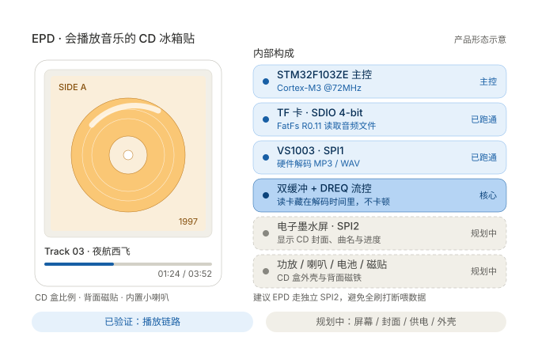
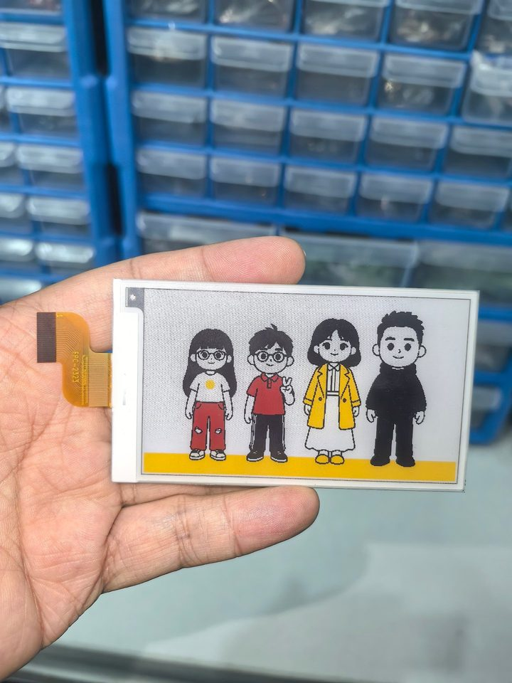

### Hi there 👋

我是 **Aaron-XSJ**，在合肥，做嵌入式和硬件 DIY：从 STM32 固件、各类接口驱动，到 BLE 设备和微信小程序，喜欢把一块开发板做成能摆在手边、能摸得到的实物。

🛠️ 常用：`STM32` · `ESP32` · `AD` · `Keil MDK` · `IAR` · `C/C++` · `FreeRTOS` · `FatFs` · `lwip` · `SPI / SDIO` · `E-Paper` · `AD / DA` · `BLE` · `Git`

---

## 🔖 正在做：EPD —— 会播放音乐的 CD 冰箱贴

一枚贴在冰箱上的音乐冰箱贴：**电子墨水屏常驻显示 CD 封面**，配上曲名与进度，按键切歌，小喇叭出声。尺寸按怀旧 CD 盒来做；不播的时候封面也留在屏上，像一张摆在冰箱门上的唱片封套。

  

> 选墨水屏，是因为断电保图、静态几乎不耗电、类纸质感接近印刷封面；只在切歌时刷新一次，反而更像实体唱片，而不是一块常亮的小电视。

**两条链路都已独立跑通**，接下来是合板：

- **播放**：STM32F103ZE 经 SDIO 4-bit 读 TF 卡，FatFs 取文件，SPI1 喂给 VS1003 硬件解码。核心是 **双缓冲（乒乓）+ DREQ 流控** —— 把读卡耗时藏在解码时间里，缓冲切换只换指针不拷贝，裸机、无 DMA 参与也能连续出声、**不卡顿**。
- **显示**：GDEM037F36 3.7" 四色墨水屏（240×416，黑 / 白 / 黄 / 红，2bpp）已点亮，[实物见下](#-墨水屏已点亮)。GPIO 模拟 SPI + BUSY 握手，一帧 24960 字节，全刷 / 快刷 / 深睡都跑过。

👉 [查看 EPD 仓库](https://github.com/Aaron-XSJ/EPD) · [双缓冲为什么不卡顿](https://github.com/Aaron-XSJ/EPD#双缓冲喂数据播放为什么不卡顿)

| 模块 | 状态 | 说明 |
| --- | --- | --- |
| 音频播放 | ✅ 已跑通 | SDIO + FatFs + VS1003，双缓冲连续播放、切歌 / 暂停、每曲独立复位 |
| 电子墨水屏 | ✅ 已独立跑通 | GDEM037F36 / JD79663CA，240×416 四色，软件 SPI + BUSY，全刷与快刷 |
| 双链路合板 | ⏳ 下一步 | 引脚基本不冲突；难点是全刷时死等 BUSY 会阻塞喂数据，需改成非阻塞刷新 |
| CD 封面 / 元数据 | ⏳ 规划中 | 封面在 PC 端预转 2bpp 位图（24960 B / 张），按曲名索引送屏 |
| 电池 / 功放 / 外壳 | ⏳ 规划中 | CD 盒比例、背面磁贴、小喇叭、可换 TF 卡 |

### 📷 墨水屏已点亮

  

3.7" 四色电子墨水屏实拍 · 黑 / 白 / 黄 / 红，断电后画面常驻

---

## 📦 开源项目

| 项目 | 一句话 | Stars |
| --- | --- | --- |
| [EPD](https://github.com/Aaron-XSJ/EPD) | STM32F103 + VS1003 双缓冲 MP3 播放器，目标是电子墨水屏 CD 封面冰箱贴 |  |

---

## 🧰 工具与方向

- 硬件：STM32F103 核心板、TF 卡（SDIO）、VS1003 解码模块、GDEM037F36 四色墨水屏
- 软件：Keil MDK / C / FatFs R0.11 / Git
- 也在折腾：BLE 固件、微信小程序、HarmonyOS / Android 小工具

📫 想聊硬件或项目，欢迎到 [EPD 仓库提 issue](https://github.com/Aaron-XSJ/EPD/issues)。

[查看全部仓库 →](https://github.com/Aaron-XSJ?tab=repositories)
